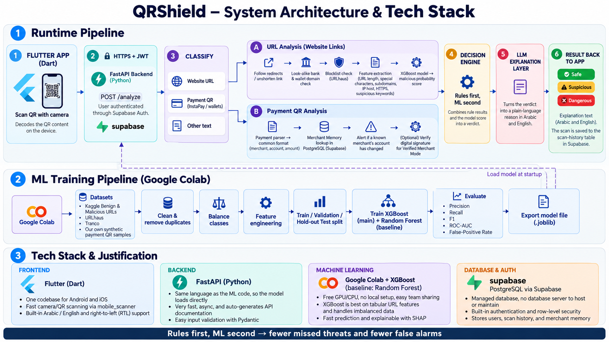

#  QRShield – QR Code Security System

Scan a QR code and know if it is safe **before** you open it or pay. QRShield checks links and payment QR codes and returns a **green / yellow / red** verdict with a simple explanation in **Arabic and English**.

---

## Table of Contents

1. [Overview](#1-overview)
2. [Features and Scope](#2-features-and-scope)
3. [Technology Stack](#3-technology-stack)
4. [Repository Structure](#4-repository-structure)
5. [Installation and Setup](#5-installation-and-setup)
6. [Datasets](#6-datasets)
7. [Running the EDA Notebook](#7-running-the-eda-notebook)

---

## 1. Overview

QR codes hide their destination until they are scanned. A tampered code can send a user to a fake website, or replace a merchant's payment QR with one that sends money to a fraudster. 

**The problem:** users cannot tell whether a QR code leads to a safe website, or whether a payment QR was tampered with, before they open it or pay.

**The solution:** QRShield is a mobile app with an analysis backend. It classifies the QR code, checks it, and tells the user how risky it is and why. Unlike most scanners that only check links, QRShield also reads **payment QR codes** (e.g. InstaPay and wallets) and **remembers merchants**, so it can warn when a familiar shop's QR suddenly points to a different account.

> QRShield reduces risk but cannot prove a perfect fake is fake. A green verdict means no risk was found by the completed checks.



---

## 2. Features and Scope

**Main features**

- Scan QR codes with the phone camera
- Classify content: website link, payment QR, or other
- Detect malicious URLs with a machine learning model (XGBoost)
- Check links: redirects, look-alike bank/wallet domains, threat blocklists
- Read payment QR codes: merchant, account and amount
- Merchant memory: warn when a known merchant's account changes
- Risk verdict: green / yellow / red (rules first, ML second)
- Plain-language explanations in Arabic and English
- Warning before opening a risky link
- Scan history

**Optional extension**

- Verified Merchant Mode using digital signatures

**Out of scope**

- QRShield never makes or confirms a payment automatically
- It does not claim to catch every possible fake

---

## 3. Technology Stack

| Layer | Technology | Why |
|-------|-----------|-----|
| Mobile app | **Flutter (Dart)** | One codebase for Android and iOS, easy camera scanning, built-in Arabic/English support |
| Backend | **FastAPI (Python)** | Same language as the ML code, fast, automatic API docs |
| Machine learning | **XGBoost** (Random Forest as baseline) | Strong on tabular URL features, handles imbalanced data |
| Training | **Google Colab** | Free cloud compute, easy to share |
| Database and auth | **PostgreSQL (Supabase)** | Managed database with built-in authentication, nothing to host |

---

## 4. Repository Structure

```
qrshield/
├── README.md
├── .gitignore
├── docs/
│   └── architecture.png
├── mobile/                 # Flutter app
├── backend/                # FastAPI service
│   ├── app/main.py
│   ├── requirements.txt
│   └── .env.example
├── ml/                     # Machine learning
│   ├── notebooks/
│   │   └── 01_eda_urls.ipynb
│   ├── data/
│   │   ├── README.md
│   │   └── raw/            # datasets (not committed)
│   └── requirements.txt
└── database/
    └── schema.sql
```

---

## 5. Installation and Setup

**Requirements:** Git, Python 3.10+, Flutter SDK, a free Supabase account.

### 1. Clone

```bash
git clone https://github.com/<your-username>/qrshield.git
cd qrshield
```

### 2. Database (Supabase)

1. Create a project at [supabase.com](https://supabase.com).
2. Open **SQL Editor**, paste `database/schema.sql` and run it.
3. Copy the **Project URL** and **anon key** from **Project Settings → API**.

### 3. Backend

```bash
cd backend
python -m venv .venv
source .venv/bin/activate        # Windows: .venv\Scripts\activate
pip install -r requirements.txt
cp .env.example .env             # Windows: copy .env.example .env
uvicorn app.main:app --reload
```

Fill in `.env` with your Supabase values. The API runs at `http://127.0.0.1:8000`, with docs at `/docs` and a health check at `/health`.

### 4. Mobile app

```bash
cd mobile
flutter pub get
flutter run
```

Use a real device or an emulator with a camera. From an Android emulator, the backend is at `http://10.0.2.2:8000`.

---

## 6. Datasets

| Dataset | Use | Link |
|---------|-----|------|
| Malicious URLs dataset (651k URLs) | Main URL training data | [Kaggle](https://www.kaggle.com/datasets/sid321axn/malicious-urls-dataset) |
| Benign and Malicious URLs | Second URL dataset | [Kaggle](https://www.kaggle.com/datasets/samahsadiq/benign-and-malicious-urls) |
| Benign and Malicious QR Codes | Image-only baseline | [Kaggle](https://www.kaggle.com/datasets/samahsadiq/benign-and-malicious-qr-codes) |

The data is **not stored in this repository**. To get it:

1. On Kaggle, go to **Settings → API → Create New Token** and download `kaggle.json`.
2. Run:

```bash
pip install kaggle
mkdir -p ~/.kaggle && mv kaggle.json ~/.kaggle/ && chmod 600 ~/.kaggle/kaggle.json

mkdir -p ml/data/raw
kaggle datasets download -d sid321axn/malicious-urls-dataset -p ml/data/raw --unzip
kaggle datasets download -d samahsadiq/benign-and-malicious-urls -p ml/data/raw --unzip
kaggle datasets download -d samahsadiq/benign-and-malicious-qr-codes -p ml/data/raw --unzip
```

You can also download each dataset manually from its Kaggle page and place the files in `ml/data/raw/`.
